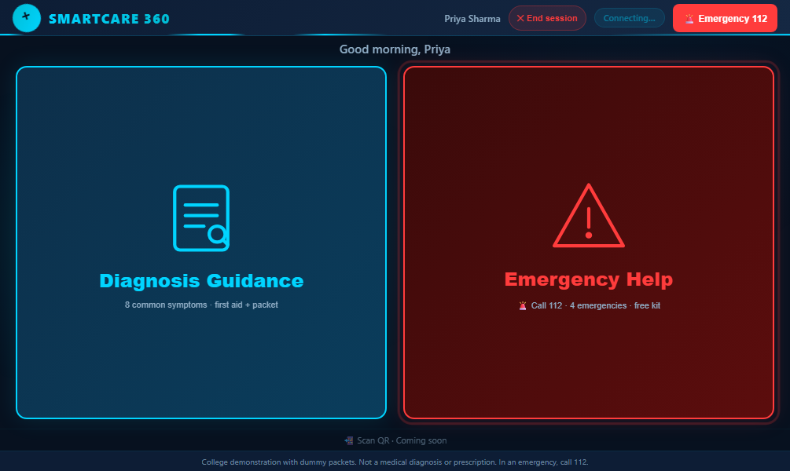

# SmartCare 360

> Smart Healthcare Kiosk — B.Pharm college project. A patient checks in on a tablet, reads first-aid advice for their symptom, pays a demo fee, and an ESP32 drops a dummy medicine packet from a servo-controlled dispenser. No real medicine, no real payment.

📖 **[Full documentation → readme/README.md](readme/README.md)**
