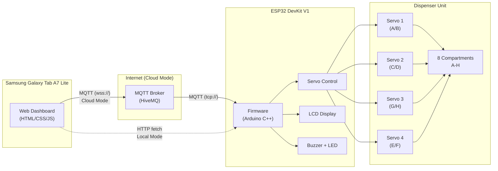
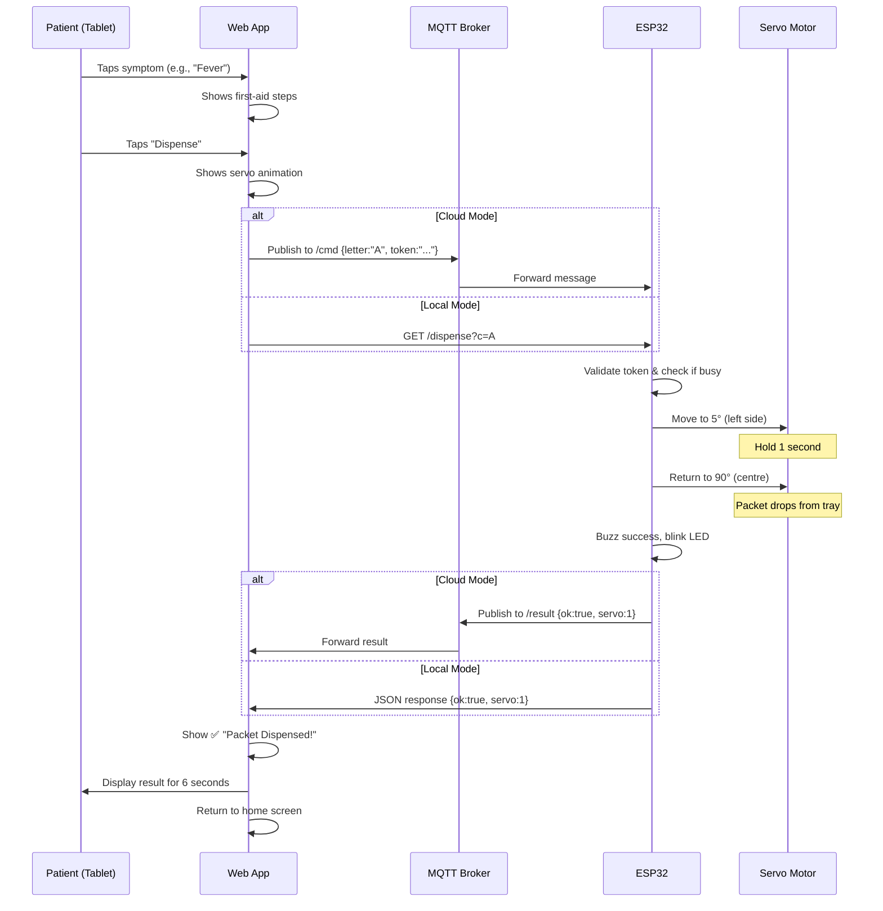

# Viva Notes – SmartCare 360

## What is SmartCare 360?

SmartCare 360 is a smart healthcare kiosk designed as a B.Pharm college demonstration project. A patient uses a **tablet web dashboard** to select their symptom, reads first-aid instructions, and taps "Dispense" to receive a **dummy medicine packet** dropped by one of four **servo motors** controlled by an **ESP32 microcontroller**.

> [!NOTE]
> This is a **college demonstration** with dummy packets. It is **not** a medical device, does not diagnose conditions, and does not prescribe real medicines.

---

## Block Diagram

---

## Flow: Tap → Dispense

---

## Three Connection Modes

| Mode | When Used | How It Works |
|------|-----------|-------------|
| **Cloud (MQTT)** | Page on Vercel, both devices on internet | Browser → MQTT (wss://) → Broker → ESP32 (tcp://) |
| **Local (HTTP)** | Page from ESP32 at `192.168.4.1` | Browser → HTTP fetch → ESP32 directly |
| **Demo** | No ESP32 found | Simulates 2.8 s dispense, no hardware |

### Why is MQTT needed?

A browser on an **HTTPS** page (Vercel) **cannot** call a plain **HTTP** endpoint (ESP32) — browsers block this as "mixed content". MQTT over **secure WebSockets (wss://)** solves this because both sides connect to a secure broker.

---

## 15 Likely Viva Questions & Answers

### 1. What microcontroller are you using?

**ESP32 DevKit V1** (30-pin, Type-C). It has built-in Wi-Fi and Bluetooth, runs at 240 MHz, and has enough GPIO pins for our 4 servos, LCD, buzzer, LED, and button.

### 2. Why ESP32 instead of Arduino Uno?

Arduino Uno has no Wi-Fi. We need Wi-Fi to connect to the web dashboard (either as an access point or as a station on a network). ESP32 has built-in Wi-Fi.

### 3. How do the servos dispense medicine?

Each SG90 servo arm holds a tray. When commanded, the arm swings from 90° (centre) to 5° (left) or 175° (right), holds for 1 second, then returns to 90°. The tilt drops the dummy packet from the tray by gravity.

### 4. Why only one servo moves at a time?

The ESP32 drives servos through PWM. Moving multiple servos simultaneously would draw too much current (each SG90 can draw 500 mA). We also set a `isBusy` flag to prevent overlapping commands.

### 5. What is MQTT?

**Message Queuing Telemetry Transport** — a lightweight publish/subscribe messaging protocol designed for IoT. The browser *publishes* a command, and the ESP32 *subscribes* to that topic. A *broker* (server) routes the messages.

### 6. What broker do you use?

**HiveMQ** public broker (`broker.hivemq.com`). The browser connects on port 8884 (secure WebSocket, `wss://`). The ESP32 connects on port 1883 (plain MQTT, `tcp://`). No account needed — it's free and public.

### 7. What is mixed content, and how did you solve it?

When a page loaded over **HTTPS** tries to fetch from a plain **HTTP** URL, the browser blocks it for security. This prevents the Vercel-hosted dashboard from calling the ESP32 directly. We solve it by using **MQTT over wss://** — both connections are encrypted, so the browser allows them.

### 8. What happens if there is no internet?

The ESP32 falls back to **access point mode**: it creates its own Wi-Fi network ("SMARTCARE360") and serves the dashboard at `http://192.168.4.1`. The tablet joins this network and uses the app offline.

### 9. How is the LCD address auto-detected?

The firmware tries three common I2C addresses (0x27, 0x3F, 0x20) using `Wire.beginTransmission()`. The first one that returns `endTransmission() == 0` is the correct address. This avoids hardcoding.

### 10. What is a service worker?

A **service worker** is a JavaScript file that runs in the background in the browser. Ours caches the app's HTML, CSS, and JS files so the dashboard still loads even if the internet connection drops after the first visit.

### 11. Why do you use a passive buzzer?

A **passive buzzer** can play different frequencies (tones) because it has no built-in oscillator — the ESP32 generates the PWM signal. An active buzzer can only make one fixed sound. We use two rising tones for success and a low tone for errors.

### 12. What is the token for?

The token is a simple shared secret between the web app and the ESP32. Since we use a **public** MQTT broker, anyone could publish to our topic. The ESP32 rejects commands with the wrong token. This is **demo-grade** security — not suitable for production.

### 13. What prevents double dispensing?

The web app sends a unique **UUID** with each command. The ESP32 keeps a buffer of the last 5 UUIDs. If it receives a command with an ID it has already processed, it ignores it.

### 14. What is PWA?

**Progressive Web App** — a web app that can be installed on the home screen and behaves like a native app (fullscreen, offline support, its own icon). Our `manifest.webmanifest` file enables this. We also cache files with a service worker.

### 15. How is the web app deployed?

We deploy to **Vercel** as a static site — no server needed. Push the code to GitHub, connect the repo to Vercel, set the root directory to `web/`, and deploy. Vercel serves the files over HTTPS from its CDN.

---

## Key Technical Terms for the Viva

| Term | Simple Explanation |
|------|-------------------|
| ESP32 | A small, cheap microcontroller with Wi-Fi, used in IoT projects |
| SG90 | A tiny hobby servo motor that can rotate to a specific angle |
| I2C | A two-wire communication protocol (SDA + SCL) for connecting peripherals like LCDs |
| MQTT | A lightweight IoT messaging protocol using publish/subscribe |
| WebSocket | A persistent two-way connection between browser and server |
| wss:// | WebSocket Secure — encrypted WebSocket (like HTTPS is encrypted HTTP) |
| PWM | Pulse Width Modulation — how the ESP32 controls the servo angle |
| PROGMEM | Stores data in flash memory instead of RAM (ESP32 has limited RAM) |
| Access Point | The ESP32 creates its own Wi-Fi network that devices can join |
| Station Mode | The ESP32 joins an existing Wi-Fi network (like your phone hotspot) |
| Last Will | An MQTT message published automatically when the ESP32 disconnects |
| Retained Message | An MQTT message stored by the broker and sent to new subscribers |
| UUID | Universally Unique Identifier — a random string to identify each command |
| CDN | Content Delivery Network — Vercel serves your files from servers worldwide |
