# SmartCare 360 — Complete Beginner Guide

> **College B.Pharm project.** A patient checks in on a tablet, reads first-aid advice, pays a demo fee, and receives a dummy packet dropped by an ESP32-controlled servo motor. No real medicine, no real payment.

---

## Block Diagram

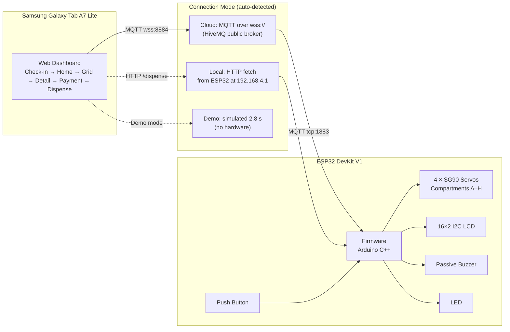

---

## User Flow

```
Check-in
  ↓ (name + mobile number)
Home — choose:
  ├── Diagnosis Guidance
  │     ↓
  │   8-symptom grid
  │     ↓ tap symptom
  │   Detail (first aid + "What may help" + "See a doctor if")
  │     ↓ Dispense packet
  │   Payment (QR + countdown + Simulate button)
  │     ↓ Simulate payment
  │   Payment Successful (2.5 s auto-advance)
  │     ↓
  │   Dispensing animation (servo drops packet)
  │     ↓
  │   Collect from tray (12 s → auto back to Check-in)
  │
  └── Emergency Help (free — no payment)
        ↓
      4-emergency grid
        ↓ tap emergency
      Detail (first aid + 112 banner)
        ↓ Dispense emergency kit
      Dispensing animation
        ↓
      Collect from tray (12 s → auto back to Check-in)
```

---

## Screenshots

> *Captured at 1005 × 600 (Samsung Galaxy Tab A7 Lite landscape)*

### Check-in
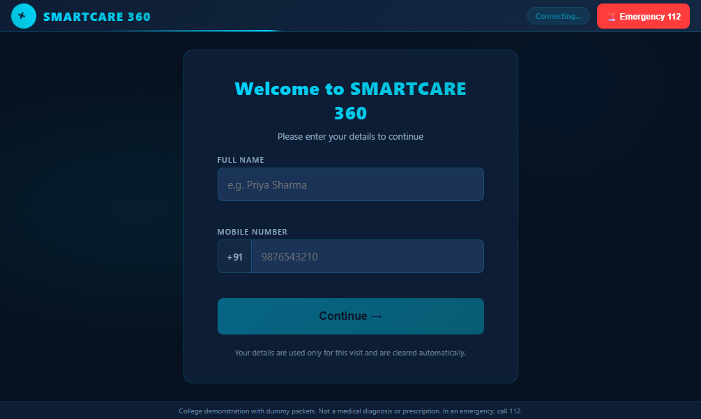

### Home
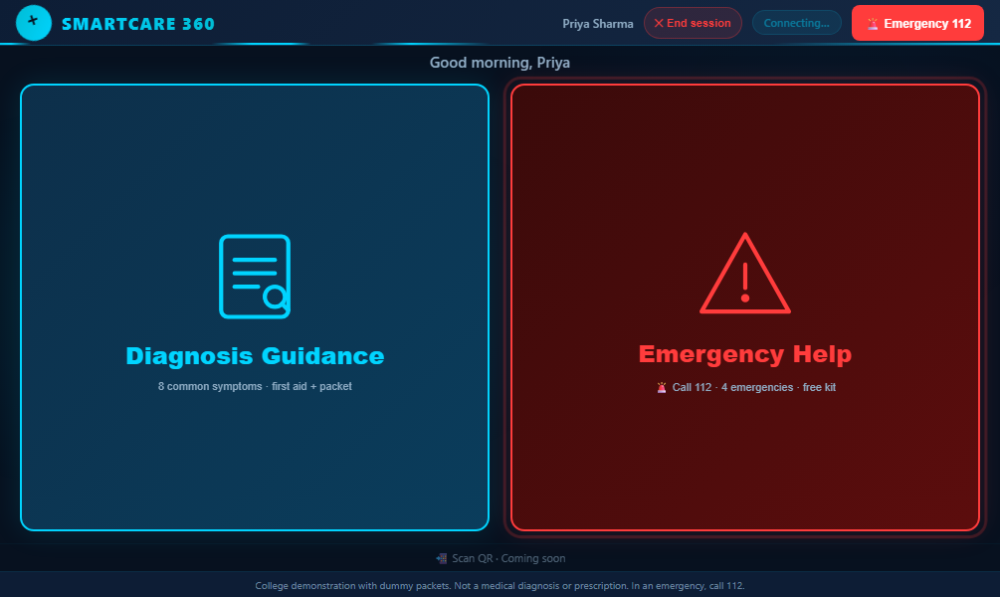

### Diagnosis Grid
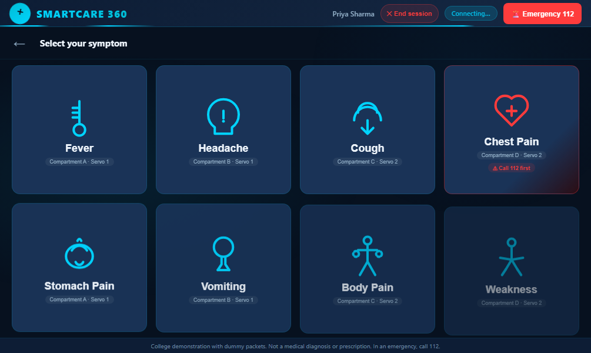

### Symptom Detail
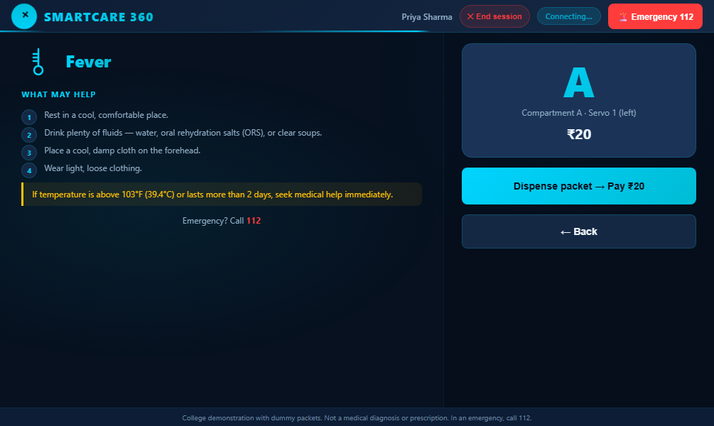

### Payment
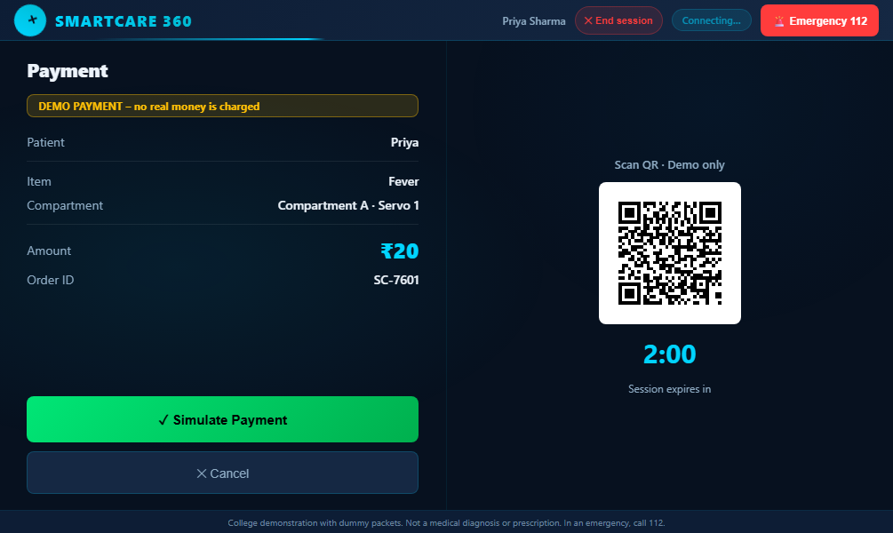

### Payment Successful
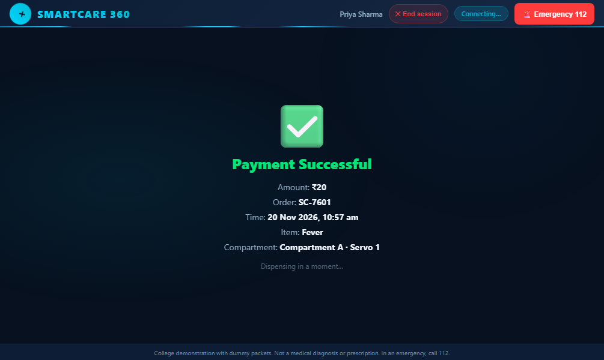

### Dispensing
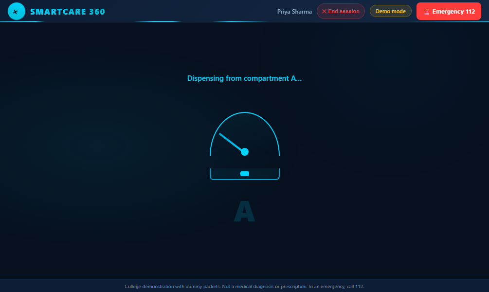

### Collect
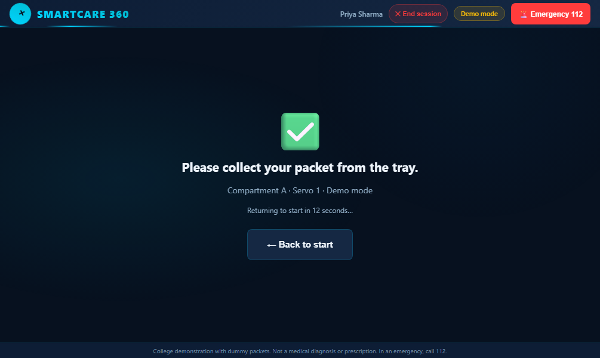

### Emergency Grid
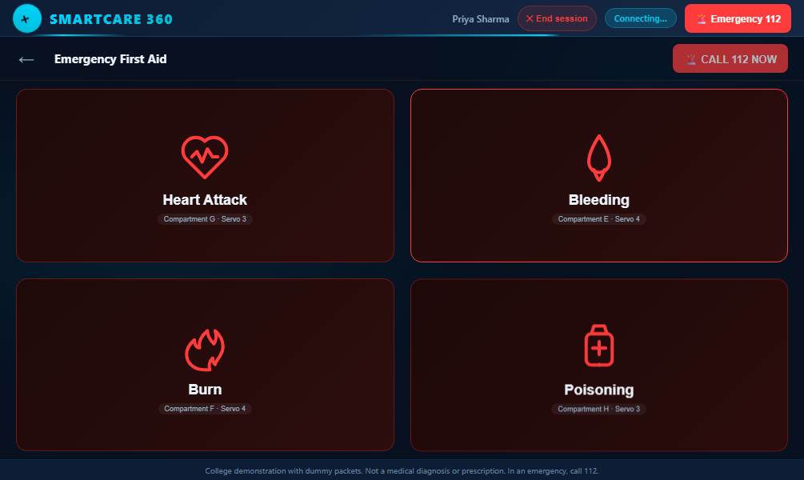

### Emergency Detail
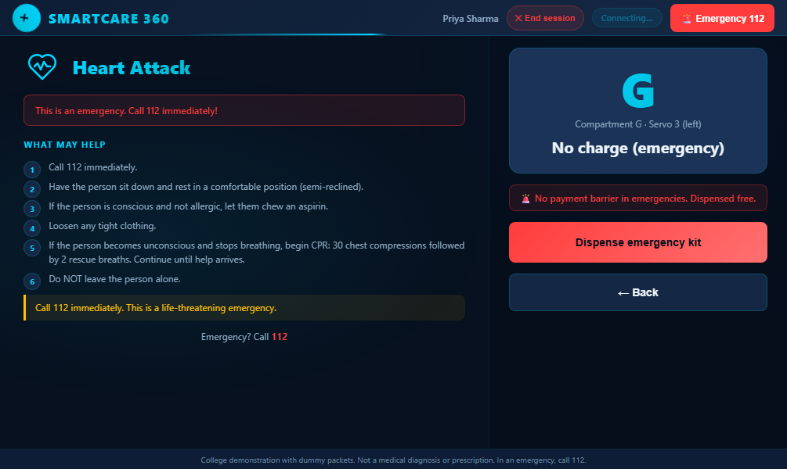

---

## Hardware List

| Component | Qty | Notes |
|-----------|-----|-------|
| ESP32 DevKit V1 (30-pin, Type-C) | 1 | DOIT ESP32 DEVKIT V1 board |
| SG90 Micro Servo | 4 | 5 V, ~500 mA stall |
| 16×2 I2C LCD | 1 | PCF8574 backpack, addr 0x27 or 0x3F |
| Passive Buzzer | 1 | Must be passive (no built-in oscillator) |
| LED | 1 | Any colour, with 220 Ω resistor |
| 220 Ω Resistor | 1 | For LED |
| Push Button | 1 | Momentary, normally open |
| External 5 V / 3 A PSU | 1 | Required — USB alone ≠ 4 servos |
| Jumper Wires + Breadboard | — | |
| Samsung Galaxy Tab A7 Lite | 1 | Chrome browser, landscape |

---

## Wiring Table

| Component | Pin | ESP32 Pin |
|-----------|-----|-----------|
| Servo 1 Signal (A/B) | orange | D18 |
| Servo 2 Signal (C/D) | orange | D19 |
| Servo 3 Signal (G/H) | orange | D23 |
| Servo 4 Signal (E/F) | orange | D32 |
| All servo VCC | red | External 5 V |
| All servo GND | brown | External GND |
| LCD SDA | — | D21 |
| LCD SCL | — | D22 |
| LCD VCC | — | 5 V (Vin) |
| LCD GND | — | GND |
| Passive Buzzer + | — | D25 |
| Passive Buzzer − | — | GND |
| LED Anode | — | D26 (via 220 Ω) |
| LED Cathode | — | GND |
| Push Button | — | D27 (INPUT_PULLUP) |
| Push Button | — | GND |

> **⚠ Power:** Use an external 5 V / 3 A supply for all servo VCC wires. Connect its GND to ESP32 GND too (shared ground). Never power servos from ESP32's 3.3 V pin.

---

## Compartment Map

| Compartment | Servo | Pin | Direction |
|-------------|-------|-----|-----------|
| A | 1 | D18 | Left (5°) |
| B | 1 | D18 | Right (175°) |
| C | 2 | D19 | Left (5°) |
| D | 2 | D19 | Right (175°) |
| E | 4 | D32 | Left (5°) |
| F | 4 | D32 | Right (175°) |
| G | 3 | D23 | Left (5°) |
| H | 3 | D23 | Right (175°) |

---

## Arduino Libraries to Install

Go to **Tools → Manage Libraries** in Arduino IDE and install:

| Library | Author | Version |
|---------|--------|---------|
| ESP32Servo | Kevin Harrington | Latest |
| LiquidCrystal I2C | Frank de Brabander | Latest |
| PubSubClient | Nick O'Leary | Latest |
| ArduinoJson | Benoit Blanchon | **v7** |

---

## secrets.h Setup

```bash
cd firmware/SmartCare360
# Copy the example:
cp secrets_example.h secrets.h
# Then edit secrets.h with your Wi-Fi name/password
```

Fill in:
```cpp
#define WIFI_SSID     "YourPhoneHotspot"
#define WIFI_PASSWORD "YourPassword"
#define DEVICE_ID     "sc360-7f3k9q"   // must match config.js
#define TOKEN         "demo-token-2024" // must match config.js
```

> `secrets.h` is in `.gitignore` — it will never be pushed to GitHub.

---

## Firmware Upload Steps

1. Connect ESP32 via USB.
2. Open `firmware/SmartCare360/SmartCare360.ino` in Arduino IDE.
3. **Tools → Board → DOIT ESP32 DEVKIT V1**
4. **Tools → Port → (select your COM port)**
5. Click **Upload** (→).
6. If upload fails: hold the **BOOT** button on the ESP32, click Upload, release after "Connecting…".
7. Open **Serial Monitor** at 115200 baud to see status.

---

## Generate Offline Dashboard

```bash
python tools/embed_web.py
```

This inlines all CSS and JS into `firmware/SmartCare360/dashboard_html.h` so the ESP32 can serve it at `http://192.168.4.1` without internet. Re-upload firmware after running this.

---

## Vercel Deployment

1. Push this repository to GitHub.
2. Go to [vercel.com](https://vercel.com) → **Add New Project**.
3. Import your GitHub repository.
4. Set:
   - **Framework Preset:** `Other`
   - **Root Directory:** `web`
   - **Build Command:** *(leave empty)*
   - **Output Directory:** *(leave empty)*
5. Click **Deploy**.

Your app is live at `https://your-project.vercel.app`!

---

## Tablet Setup

### Cloud Mode (Recommended)
1. Connect your phone as a hotspot.
2. Connect the ESP32 — LCD shows "Cloud ready".
3. Connect the tablet to the **same hotspot**.
4. Open Chrome → `https://your-project.vercel.app`
5. Header shows: **"Dispenser connected · Cloud"**

**Install as app:**
Chrome menu (⋮) → Add to Home screen → opens fullscreen.

### Local Mode (Offline Backup)
1. Power on ESP32 without Wi-Fi (or wrong credentials).
2. LCD shows: "Offline mode / 192.168.4.1"
3. On tablet: Wi-Fi Settings → connect to **SMARTCARE360** (password: smartcare360).
4. Tap "Stay connected" (no internet — expected).
5. Open Chrome → `http://192.168.4.1`
6. Header shows: **"Dispenser connected · Local"**

### Demo Mode
1. Open any browser → `https://your-project.vercel.app`
2. No ESP32 needed — simulates everything.
3. Header shows: **"Demo mode"**

---

## Troubleshooting

| Problem | Solution |
|---------|----------|
| "Demo mode" even with ESP32 on | DEVICE_ID and TOKEN in `config.js` must match `secrets.h`. Long-press logo → Settings. |
| LCD shows nothing | Check SDA→D21, SCL→D22. Turn the contrast pot on the I2C backpack. |
| Servo doesn't move | Use external 5 V supply. Check all GNDs are connected. |
| Servo jitters | Add 100 µF cap across servo VCC/GND. |
| Upload fails | Select DOIT ESP32 DEVKIT V1. Hold BOOT during "Connecting…". |
| Wi-Fi won't connect | Must be 2.4 GHz. Check SSID/password exactly (case-sensitive). |
| "No internet" on tablet | Expected in Local mode (AP). Tap "Stay connected". |

---

## Limitations

- Demo payment only — no real UPI or bank integration.
- Public MQTT broker — anyone knowing the topic can subscribe (demo-grade security).
- Dummy packets only — no real dispensing mechanism.
- No patient records stored (by design — privacy).

## Future Scope

- Real UPI payment integration.
- Biometric patient identification.
- Medicine inventory tracking.
- Cloud patient history dashboard (with consent).
- Multiple dispensers on one dashboard.
- Private MQTT broker with TLS certificates.
